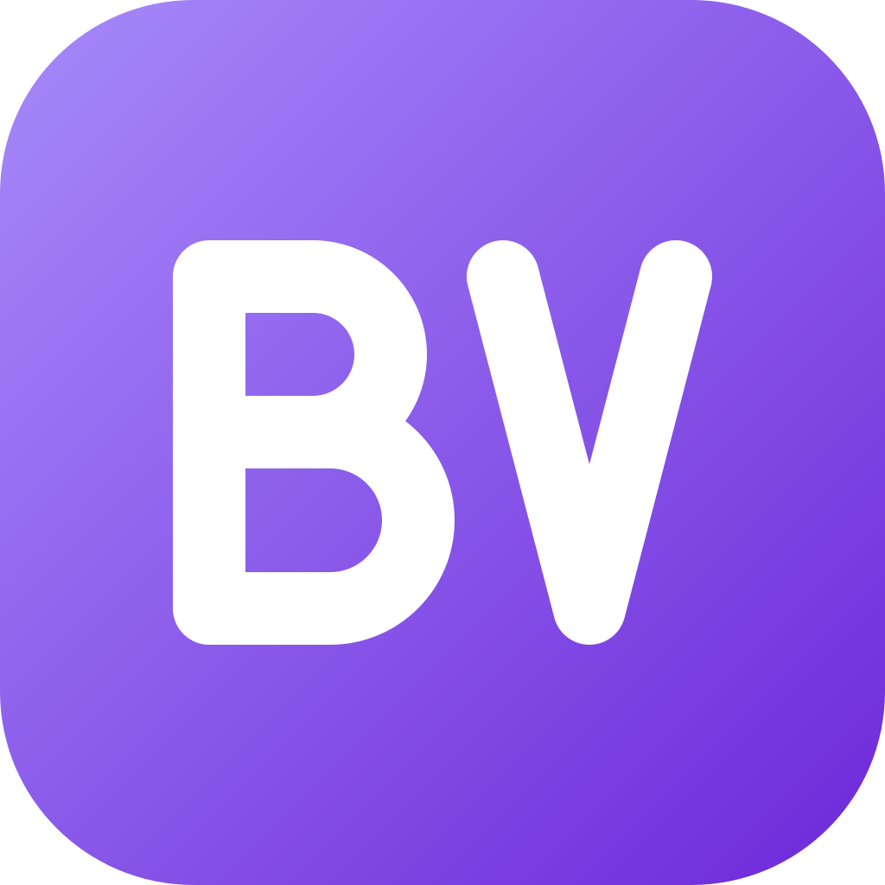
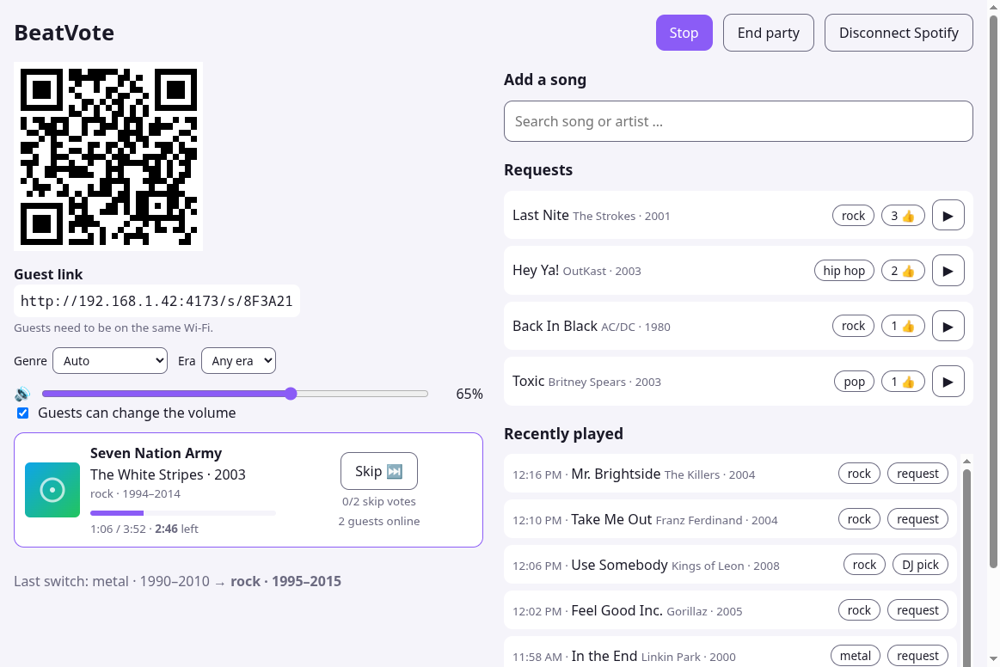
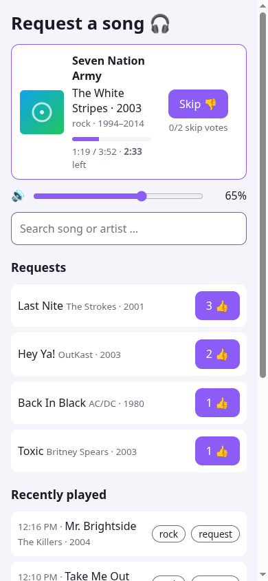
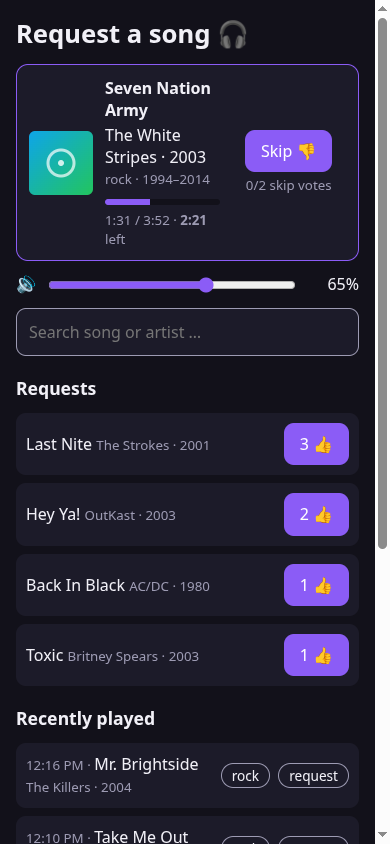
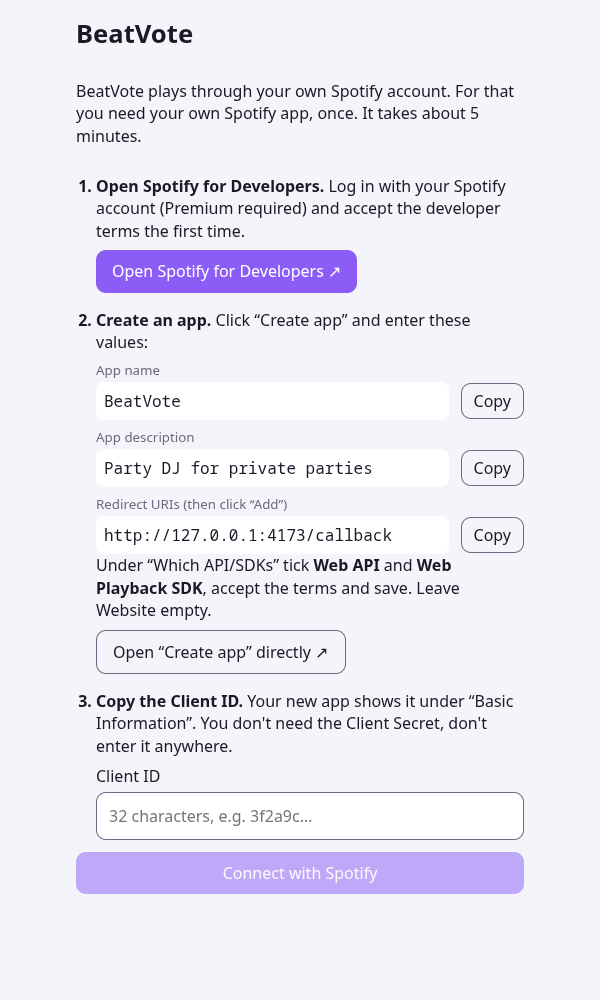

<p align="center"></p>

<h1 align="center">BeatVote</h1>

<p align="center"><b>Your guests pick the music. The DJ keeps the vibe.</b></p>

BeatVote turns an Android tablet, phone or TV into a party DJ. Guests scan a QR code, search for songs and vote for them. An automatic DJ plays the most wanted songs through Spotify and stays in the current style, genre and era, as long as the crowd wants it.

<p>
  
</p>
<p>
  
  
  
</p>

## Features

- **Guests need nothing but a browser.** They scan the QR code, search for songs and request or upvote them. No app, no Spotify account, no login.
- **A DJ that reads the room.** Requests with more votes play first. The DJ stays in a phase (a genre family within ±10 years of the song that started it) and only switches when another style is clearly wanted, so Linkin Park isn't followed by a 1980 AC/DC track just because both count as rock.
- **Never silent.** When the request list runs dry, the DJ keeps playing from the current genre and era and avoids artists heard in the last 20 songs.
- **Skip voting.** If more than half of the guests online want to skip a song, it's skipped.
- **Host controls.** Search and queue songs, play one right away, skip, reorder the requests, pin a genre and/or decade, set the volume and lock it for guests.
- **Party screen.** A clean view for everyone to see: QR code, now playing, up next, requests and history. Light or dark.
- **Android TV.** Runs on Android TV boxes such as the NVIDIA Shield, controlled with the remote.
- **Play anywhere.** Play on the device itself or on any Spotify Connect device, e.g. the Spotify app on your TV.
- **Device volume sync.** On Android the volume slider is the device's media volume, including the hardware buttons.
- **Remaining time, recently played and resume.** Close the app and pick the party up again with the same QR code.
- **Runs entirely on the device.** The server is embedded in the app; guests connect over the local Wi-Fi.

## How it works

```
 Guests (any browser)                 Host device (Android app)
 ┌──────────────────┐    Wi-Fi    ┌──────────────────────────────────────┐
 │ search, request, │ ──────────▶ │ BeatVote server (embedded Node.js)   │
 │ vote, skip vote  │ ◀────────── │  · requests, votes, DJ decisions     │
 └──────────────────┘  WebSocket  │  · genres via Spotify / MusicBrainz  │
                                  │ Host UI + Spotify Web Playback SDK   │──▶ speakers
                                  └──────────────────────────────────────┘
```

Genres come from Spotify. When Spotify has none for an artist, BeatVote falls back to community tags from [MusicBrainz](https://musicbrainz.org) and maps everything onto a few families (rock, metal, hip hop, house, …).

## Requirements

- **Spotify Premium** for the host. Guests don't need Spotify.
- **Your own Spotify developer app** (free). The app walks you through it on first start, it takes about five minutes.
- An **Android** tablet, phone or TV (tested on Android 11, 16 and 17). Guests have to be on the same Wi-Fi.
- On Android TV: the **Spotify app** on the TV, BeatVote plays through it.

## Spotify setup (once per host)

1. Create an app at <https://developer.spotify.com/dashboard> with the APIs **Web API** and **Web Playback SDK**.
2. Add the redirect URI `http://127.0.0.1:4173/callback` (for local development also `http://127.0.0.1:5173/callback`).
3. Paste the Client ID into BeatVote. It's stored on the device and survives restarts and updates.

No Client Secret is needed (the login uses PKCE). Spotify apps in development mode allow the owner and up to five added users; guests don't count.

## Development

```bash
npm install
npm run dev                # server :3100 + web :5173
npm test                   # unit tests (DJ logic, sessions)
npx tsc --noEmit -p server # type check
npx tsc --noEmit -p web
```

Open the host page at **http://127.0.0.1:5173** (not `localhost`: Spotify only allows http redirects for the loopback IP).

## Project structure

| Path | What's inside |
|------|---------------|
| `server/` | Fastify server: sessions, requests, votes, the DJ logic (`src/dj/`), Spotify and MusicBrainz providers |
| `web/` | React UI for host and guests |
| `shared/` | Types and helpers used by server and UI |
| `mobile/` | Android app (Capacitor) with the embedded Node.js server |

## Maybe later

Ideas, no promises:

- **Desktop app** for Windows, macOS and Linux, with the host page in the system browser.
- **Your own music library:** play your own files through a media server on your NAS or home server, such as Navidrome, Jellyfin or Plex. No streaming account needed.
- **More streaming services**, but only those that allow it in their terms and offer a suitable API.

## Status and limitations

- Experimental, made for **private parties**. Public events need their own music licences.
- Spotify doesn't officially support its Web Playback SDK on mobile devices. It works on the tested phones and tablets but could break. On Android TV it doesn't work, so BeatVote plays through the Spotify app there.
- Remasters and compilations carry their own (later) release year, which can put a song into the wrong era.
- Genre families are a heuristic; some artists sit on the border (e.g. rock vs. metal).

## Credits

- Genre tags from [MusicBrainz](https://musicbrainz.org), used when Spotify has no genres for an artist.
- Playback and search through the [Spotify Web API and Web Playback SDK](https://developer.spotify.com). BeatVote is not affiliated with or endorsed by Spotify.

## License

Copyright (C) 2026 appstack-lab

BeatVote is free software: you can redistribute it and/or modify it under the terms of the GNU General Public License as published by the Free Software Foundation, either version 3 of the License, or (at your option) any later version.

BeatVote is distributed in the hope that it will be useful, but WITHOUT ANY WARRANTY; without even the implied warranty of MERCHANTABILITY or FITNESS FOR A PARTICULAR PURPOSE. See the [GNU General Public License](LICENSE) for more details.
